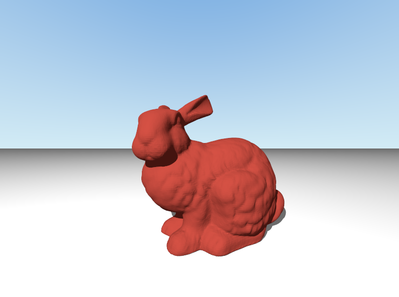
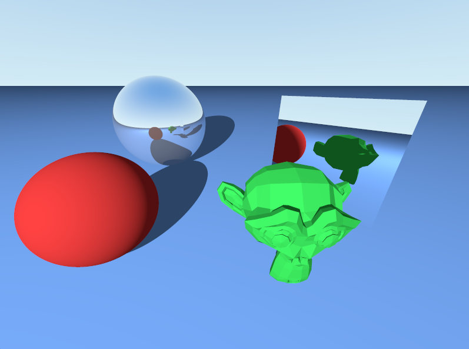
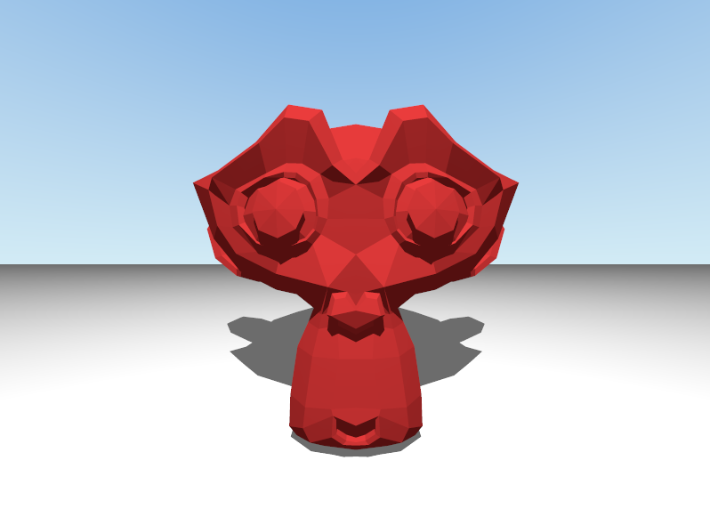

# C++ Ray Tracing Engine

A CPU-based 3D ray tracing engine built from scratch in C++, featuring geometric primitives, mesh loading, lighting, reflections, and Bounding Volume Hierarchy (BVH) acceleration.

The project explores the fundamentals of 3D rendering, geometric intersection algorithms, spatial acceleration structures, and performance optimization.

## Showcase





## Features

### Rendering

- **Ray tracing:** Casts rays through the scene to calculate pixel colors.
- **Camera:** Perspective camera with configurable position, orientation, field of view, and aspect ratio.
- **Geometric primitives:** Sphere, plane, triangle, and axis-aligned bounding box.
- **Triangle meshes:** Supports rendering complex 3D models composed of triangles.
- **OBJ loading:** Loads triangle mesh geometry from Wavefront OBJ files, including vertex normals and texture coordinates.
- **Object transformations:** Supports translation, rotation, and scaling using transformation matrices.
- **Lighting:** Point lights with direct Lambertian diffuse shading and ambient lighting.
- **Shadows:** Hard shadows calculated using shadow rays.
- **Reflections:** Supports reflective ray tracing.
- **Background:** Gradient background shading.
- **Supersampling:** Supports multiple samples per pixel to improve image quality.
- **Color pipeline:** Uses linear RGB internally and converts to sRGB for final output.

### Performance

- **Bounding Volume Hierarchy (BVH):** Accelerates mesh intersection queries using a recursively constructed, median-split hierarchy of axis-aligned bounding boxes.
- **Performance instrumentation:** Tracks render time, rays traced, shadow rays, triangle intersection tests, and rendering throughput.
- **Benchmarking:** Measures the impact of BVH acceleration against brute-force triangle intersection testing.

## Performance



### BVH acceleration: Before vs. After

The following benchmark compares brute-force mesh intersection testing with BVH-accelerated intersection testing using the same scene and rendering settings.

**Test configuration**

- Build configuration: Release
- CPU: Intel Core i7-12700F (12 cores, 20 logical processors)
- Compiler: MSVC 19.38.33135
- Build system: CMake + Visual Studio 2022 (MSBuild)
- Target architecture: x64
- Resolution: 800 × 600
- Sampling: 16 samples per pixel (4 × 4 grid)
- Scene: Suzanne mesh containing 968 triangles and a plane
- Lighting: Point light

| Metric | Before BVH | After BVH |
|---|---:|---:|
| Render time | 199.992 s | 1.974 s |
| Pixels rendered | 480,000 | 480,000 |
| Primary rays | 7,680,000 | 7,680,000 |
| Rays traced | 7,680,000 | 7,680,000 |
| Shadow rays | 4,641,906 | 4,641,906 |
| Triangle intersection tests | 11,927,605,008 | 75,125,291 |
| Pixels per second | 2,400.1 | 243,133 |
| Rays per second | 38,401.6 | 3,890,130 |
| Triangle tests per primary ray | 1,553.07 | 9.78194 |

### Results

- **101.30× faster rendering** on the benchmark scene.
- **99.01% reduction** in render time.
- **99.37% fewer triangle intersection tests.**

The original implementation tested mesh triangles using brute force. With BVH acceleration, rays first test bounding boxes and only traverse relevant branches of the hierarchy. Triangle intersection tests are performed at leaf nodes rather than against every triangle in the mesh.

In this benchmark, BVH acceleration reduced triangle intersection tests from approximately 11.93 billion to 75.13 million while rendering the same number of pixels and tracing the same number of primary and shadow rays.

This substantially reduces unnecessary geometric intersection calculations and makes rendering complex meshes far more practical.

*Benchmark results are from the recorded runs and may vary with hardware, compiler settings, and system load.*

## How It Works

### 1. Ray generation

The camera generates rays through the image plane. Each ray is traced into the scene to determine which object it intersects and what color should be returned.

### 2. Intersection testing

Scene objects implement ray intersection queries. When a ray intersects an object, the engine records the intersection distance and relevant primitive information to determine the closest hit.

### 3. Shading

At a hit point, the renderer evaluates the surface material and lighting. Shadow rays determine whether the light is obstructed, while reflective rays contribute reflected color.

### 4. Mesh acceleration

Testing every triangle in a complex mesh for every ray becomes expensive. The BVH organizes triangles into a hierarchy of bounding boxes.

During traversal, the engine rejects entire subtrees when a ray misses their bounding boxes. When a leaf is reached, only its stored triangles need to be tested.

The current implementation uses median splitting along the longest axis of a node's bounding box, with up to four triangles per leaf.

## Technologies

- **C++** — Rendering engine, geometry, intersection algorithms, and acceleration structures.
- **SFML 3** — Image display.
- **Wavefront OBJ** — 3D mesh input format.

## Building and Running

### Requirements

- C++ compiler supporting the C++ standard specified in `CMakeLists.txt`
- CMake
- SFML 3

### Windows

Install a compatible C++ compiler and SFML 3, then configure and build using CMake.

```powershell
cmake -S . -B build
cmake --build build --config Release
```

Run the generated executable from the appropriate configuration directory.

### Linux

Install a C++ compiler, CMake, and SFML 3 using your distribution's package manager.

```bash
cmake -S . -B build -DCMAKE_BUILD_TYPE=Release
cmake --build build
```

Run the generated executable from the build directory.

### macOS

Install Xcode Command Line Tools, CMake, and SFML 3. If using Homebrew, install the required dependencies first.

```bash
cmake -S . -B build -DCMAKE_BUILD_TYPE=Release
cmake --build build
```

Run the generated executable from the build directory.

### Notes

- Ensure CMake can locate SFML 3 on your system.
- The exact executable location depends on your platform, generator, and CMake target configuration.
- For debugging, configure a Debug build instead of Release.

## Running Tests

Execute the complete test suite:

```bash
ctest --test-dir build --output-on-failure
```

## Project Goals

This project was developed to explore and implement the fundamentals of a ray tracing renderer, with an emphasis on understanding the underlying mathematics and algorithms rather than relying entirely on a prebuilt rendering framework.

Key areas of focus include:

- 3D geometry and coordinate transformations.
- Ray-object intersection algorithms.
- Lighting, shadows, and reflections.
- Recursive spatial acceleration structures.
- Performance measurement and optimization.

## License

Licensed under the terms in `LICENSE`.
